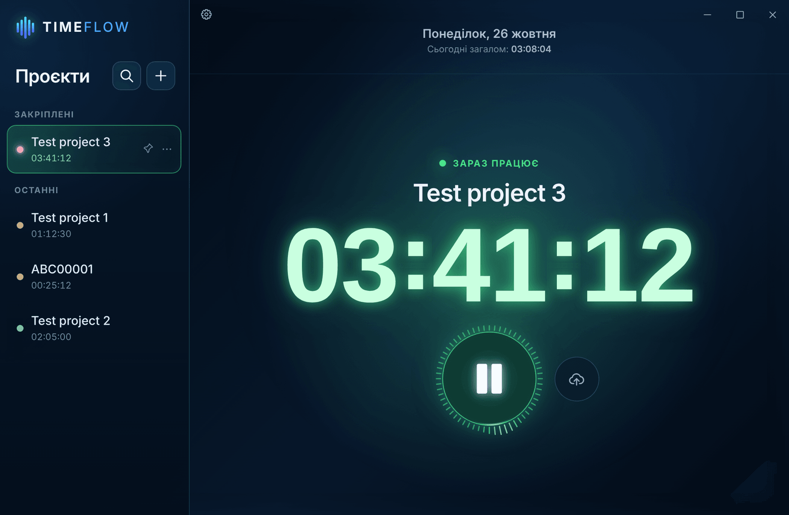
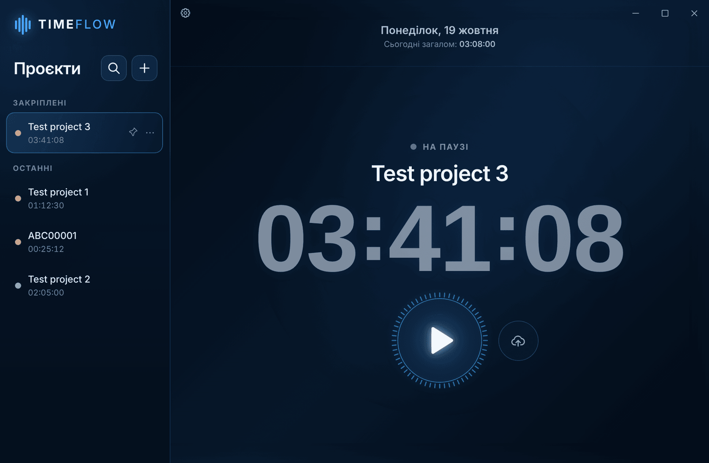
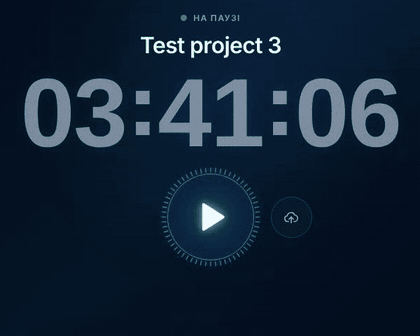
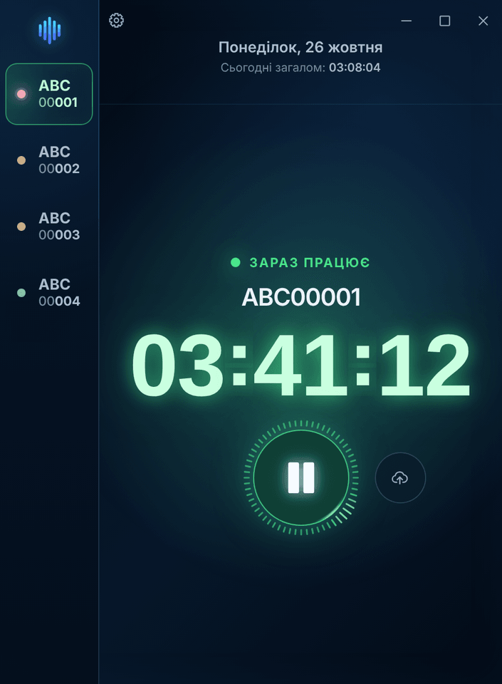
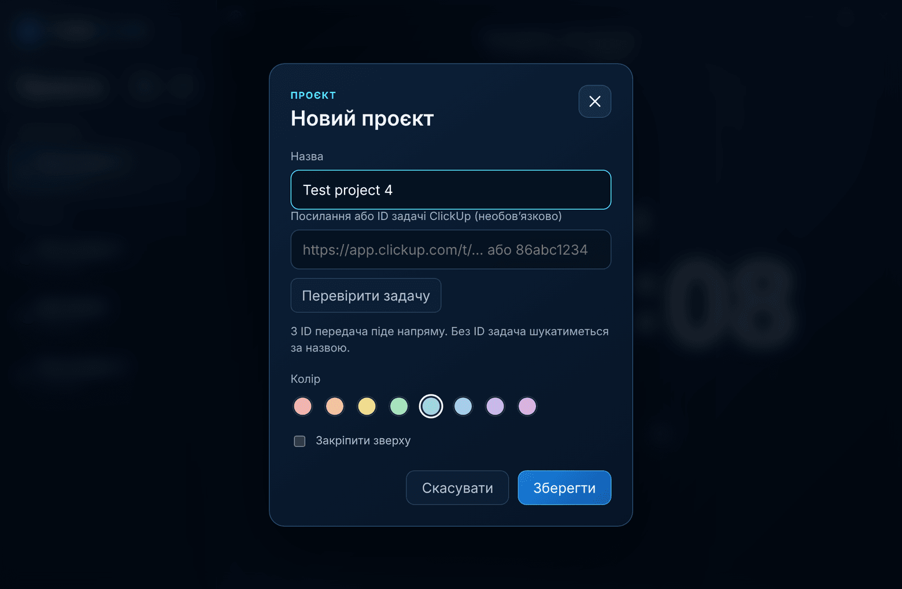
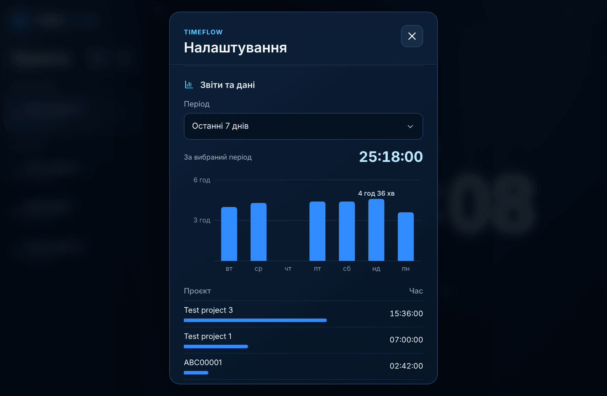
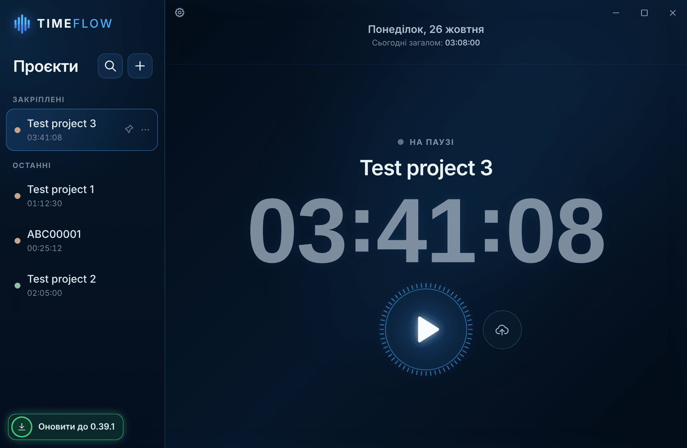

# TIMEFLOW

Таймер робочих проєктів для Windows 11. Рахує час окремо по кожному проєкту, показує загальний час за день і передає години в задачі ClickUp.

## Завантаження

Остання версія лежить у [Releases](https://github.com/antonflash/timeflow-releases/releases/latest), файл `TIMEFLOW-Setup-X.Y.Z.exe`.

У цьому репозиторії тільки інсталятори, вихідний код закритий.

## Встановлення й оновлення

Програма ставиться в профіль користувача, права адміністратора не потрібні. Інсталятор не підписаний, тому Windows SmartScreen може показати вікно «Windows захистила ваш ПК». Щоб продовжити, натисніть «Докладніше», а потім «Виконати в будь-якому разі».

Нові версії TIMEFLOW завантажує сам. Коли оновлення готове, зліва внизу з'являється значок. Клік по ньому перезапускає програму вже з новою версією, а без кліку оновлення встановиться під час закриття.

## Скріншоти

| Таймер іде | Пауза |
|---|---|
|  |  |

| Вузьке вікно | Передача в ClickUp |
|---|---|
|  |  |

| Новий проєкт | Звіти |
|---|---|
|  |  |

На скріншотах тестові проєкти. На Windows фон вікна ще й напівпрозорий.

## Можливості

- Одночасно йде один таймер. Запуск іншого проєкту ставить попередній на паузу.
- Звіти за день, тиждень, місяць і весь час, експорт у CSV.
- Передача часу в задачу ClickUp за посиланням, ID або назвою.
- Закріплені проєкти, кольори, пошук і компактна панель для вузького вікна.
- Значок у треї та маленьке вікно поверх інших програм.
- Щоденна резервна копія в `Документи\TIMEFLOW\backups`.

## Дані

Проєкти, час і налаштування зберігаються тільки на комп'ютері. Токен ClickUp шифрується засобами Windows. В інтернет програма звертається лише до ClickUp, коли передає час, і до цього репозиторію, щоб перевірити оновлення.

## Видалення

Параметри Windows → Програми → Встановлені програми → TIMEFLOW → Видалити.

Дані після видалення лишаються в `%APPDATA%\timeflow-prototype`, тож після повторного встановлення все буде на місці. Щоб прибрати їх повністю, цю папку треба видалити вручну.

---

## English

TIMEFLOW is a project timer for Windows 11. It tracks time per project, shows the daily total and sends hours to ClickUp tasks.

**Download:** the latest `TIMEFLOW-Setup-X.Y.Z.exe` is in [Releases](https://github.com/antonflash/timeflow-releases/releases/latest). This repository only holds installers; the source code is closed.

**Install:** no administrator rights needed. The installer is not signed, so Windows SmartScreen may say "Windows protected your PC". Click "More info", then "Run anyway". Updates download automatically; an icon at the bottom left restarts the app on the new version.

**Data:** everything stays on the computer. The ClickUp token is encrypted by Windows. The app only goes online to send time to ClickUp and to check this repository for updates.

**Uninstall:** Windows Settings → Apps → Installed apps → TIMEFLOW → Uninstall. Data stays in `%APPDATA%\timeflow-prototype`; delete that folder to remove it completely.
